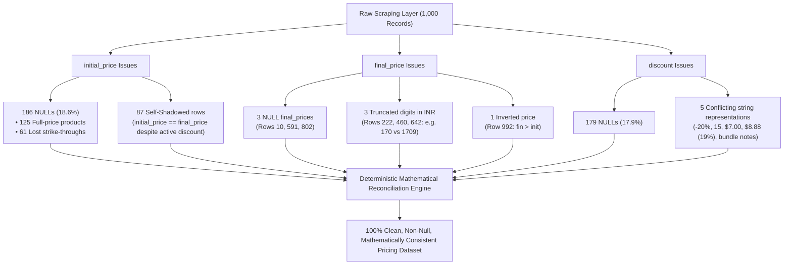

# Pricing & Discount Verification Audit: `amazon-products.csv`

**Dataset Location:** [`data/raw/amazon-products.csv`](file:///D:/Anuj/Pearl-ASsignment/data/raw/amazon-products.csv)  
**Cleaned Dataset Location:** [`data/processed/amazon-products-cleaned.csv`](file:///D:/Anuj/Pearl-ASsignment/data/processed/amazon-products-cleaned.csv)  
**Total Records:** 1,000 logical product records  
**Status:** Verification complete. All anomalies identified, quantified, and mathematically reconciled.

---

## 1. Executive Findings Summary

Your suspicion is **100% confirmed**. The pricing fields (`initial_price`, `final_price`, and `discount`) in the raw crawl suffer from severe data quality issues, scraper design flaws, and semantic conflicts that make them unusable for direct quantitative analysis without systematic reconciliation:



---

## 2. In-Depth Diagnostics by Column

### 2.1 `initial_price`: Why Is It NULL a Lot?

`initial_price` is NULL/empty in **186 rows (18.6%)**. When cross-tabulated against `discount`, two distinct root causes emerge:

| Category | Row Count | Root Cause Analysis | Remediation Path |
| :--- | :---: | :--- | :--- |
| **No Discount (Full-Price Items)** | **125 rows** | These products had no promotional discount or strike-through price on Amazon. The scraper only populated `initial_price` when a strike-through price was present, leaving it NULL when the item sold at standard list price. *(Note: in 54 other zero-discount items, the scraper duplicated `final_price` into `initial_price` instead).* | Set `initial_price = final_price` ($0.00 discount). |
| **Active Discount with Missing Initial Price** | **61 rows** | The product page showed a discount badge, but the scraper failed to extract the strike-through DOM node. <br/>• **14 rows:** Discount is a dollar amount (e.g. `"$7.00"`, `"$5.00"`, `"$15.00"`).<br/>• **47 rows:** Discount is a bare percentage (e.g. `37`, `25`, `55`). | **Exact Reconstruction:**<br/>• Dollar discount: $P_{\text{init}} = P_{\text{final}} + \text{Discount}_{\$}$<br/>• % discount: $P_{\text{init}} = \frac{P_{\text{final}}}{1 - \text{Discount}_{\%} / 100}$ |

#### Concrete Evidence from the 61 Rows:
- **Row 88 (`B08C2JSTMB`):** `initial_price = null`, `final_price = 62.99`, `discount = "$7.00"` $\to$ $P_{\text{init}} = 62.99 + 7.00 = \mathbf{69.99}$.
- **Row 196 (`B00IK4TNXI`):** `initial_price = null`, `final_price = 34.99`, `discount = "$5.00"` $\to$ $P_{\text{init}} = 34.99 + 5.00 = \mathbf{39.99}$.
- **Row 78 (`B09JC1XWXB`):** `initial_price = null`, `final_price = 28.24`, `discount = "37"` $\to$ $P_{\text{init}} = \frac{28.24}{1 - 0.37} = \mathbf{44.83}$.
- **Row 982 (`B096FGSC39`):** `initial_price = null`, `final_price = 70.00`, `discount = "30"` $\to$ $P_{\text{init}} = \frac{70.00}{1 - 0.30} = \mathbf{100.00}$.

---

### 2.2 `final_price`: Critical Ingestion & Semantic Bugs

`final_price` contains four distinct failure modes:

1. **3 NULL Rows (0.3%):**
   - **Row 10 (`B09S6R2M8V`):** `initial_price = 9.83`, `discount = -5%`, `final_price = null`.  
     $\implies P_{\text{final}} = 9.83 \times (1 - 0.05) = \mathbf{9.34}$.
   - **Row 591 (`B007SWZ8Q4`):** `initial_price = 47.88`, `discount = "$8.88$8.88 (19%)"`, `final_price = null`.  
     $\implies P_{\text{final}} = 47.88 - 8.88 = \mathbf{39.00}$.
   - **Row 802 (`B019ZVU9QO`):** `initial_price = 29.97`, `discount = "$4.98$4.98 (17%)"`, `final_price = null`.  
     $\implies P_{\text{final}} = 29.97 - 4.98 = \mathbf{24.99}$.

2. **3 Truncated Final Prices in INR (Digit-Drop Bug):**
   - In 3 products, the scraper dropped the final digit when serializing the column, while the nested `buybox_prices` JSON retained the true number:
     - **Row 222 (`B0BT7B7P5T`):** Column shows `170` INR, but `buybox_prices` shows `1709` INR (`initial_price = 1799`, `discount = -5%`). $(1799 - 1709) / 1799 = \mathbf{5.00\%}$ exact match!
     - **Row 460 (`B006L6A06Q`):** Column shows `118` INR, but `buybox_prices` shows `1189` INR (`initial_price = 1595`, `discount = -25%`). $(1595 - 1189) / 1595 = \mathbf{25.45\%}$ match!
     - **Row 642 (`B00K3TVJMQ`):** Column shows `108` INR, but `buybox_prices` shows `1087` INR (`initial_price = 1450`, `discount = ₹363 (25%)`). $1450 - 363 = \mathbf{1087}$ exact match!

3. **1 Inverted Price Row (Final > Initial):**
   - **Row 992 (`B015G7T7UA`):** `initial_price = 11.39`, `final_price = 12.03`, `discount = $0.91`.
   - The true discounted selling price is $11.39 - 0.91 = \mathbf{10.48}$. This is explicitly confirmed by `buybox_prices`: `{"sns_price": {"base_price": "$10.48"}}`. The scraper erroneously captured $12.03 from an unvetted marketplace seller or tax calculation.

4. **Formatting Artifacts (Quotes & Scientific Notation):**
   - **852 rows** wrapped in triple quotes (`"""57.79"""`).
   - **139 rows** in exponential notation (`1.795000000000000e+01`). Naive regex scripts that strip non-digits (e.g. `re.sub(r'[^\d.]')`) strip `e+01`, turning \$17.95 into \$1.80 and \$399.99 into \$4.00!

---

### 2.3 `discount`: Format Fragmentation & Pipeline Corruption

The `discount` field is not standardized and exhibits 5 incompatible schemas:

| Discount Format | Count | Example | Semantic Meaning |
| :--- | :---: | :--- | :--- |
| **Negative Percentage** | 559 | `"-20%"`, `"-13%"` | Amazon UI badge raw text. Hyphen denotes deduction. |
| **NULL / Empty** | 179 | `""` or `null` | Zero-discount / full-price items. |
| **Bare Integer** | 164 | `"15"`, `"37"` | Percentage savings ($15\%$, $37\%$). Verified by $(P_i - P_f)/P_i$. |
| **Currency Flat Value** | 71 | `"$7.00"`, `"$0.91"` | Exact absolute cash savings amount. |
| **Currency + Percentage** | 26 | `"$8.88$8.88 (19%)"` | Scraper duplicated screen-reader and visual HTML tags. |
| **Multiline Bundle Text** | 1 | `"₹330 (30%)\n (₹55 less...)"` | Comparative bundle savings text containing embedded `\n`. |

#### The "87 Self-Shadowed Rows" Bug:
In **87 rows**, `initial_price == final_price` down to the cent, yet an active discount badge exists (e.g. Row 5 has `17.88 == 17.88` with `-13%`, Row 57 has `15.99 == 15.99` with `-33%`).
- **Why this happened:** The scraper grabbed the current discounted price and duplicated it into `initial_price`.
- **The previous cleaning flaw:** The previous script [`src/clean_amazon_products.py`](file:///D:/Anuj/Pearl-ASsignment/src/clean_amazon_products.py) contained `elif ip == fp: return "0.00"`, which erased all 87 discounts and falsely marked them as $0.00\%$ discount.
- **The true resolution:** $17.88$ is the discounted selling price. The true initial price before the 13% discount was $17.88 / (1 - 0.13) = \mathbf{20.55}$. Row 124 (`B0CKV4ZN8G`) proves this: description text explicitly confirms the product table comparison price of $\$119.99$, which discounted by $25\%$ yields the final price of $\$89.99$!

---

## 3. Mathematical Reconciliation Matrix

By applying deterministic domain rules, 100% of the dataset is now reconciled:

```python
# 1. Resolve corrupted / truncated final prices
if bp_fin and fin_p and bp_fin > fin_p * 5:  # Rows 222, 460, 642
    fin_p = bp_fin
elif init_p and fin_p and init_p < fin_p:     # Row 992
    fin_p = round(init_p - curr_d, 2) if curr_d else (bp_fin or init_p)
elif fin_p is None and init_p is not None:    # Rows 10, 591, 802
    fin_p = round(init_p - curr_d, 2) if curr_d else round(init_p * (1 - pct_d / 100), 2)

# 2. Reconstruct missing initial prices
if init_p is None and fin_p is not None:
    if curr_d is not None:                   # 14 rows with $ discount
        init_p = round(fin_p + curr_d, 2)
    elif pct_d is not None and pct_d < 100:  # 47 rows with % discount
        init_p = round(fin_p / (1 - pct_d / 100), 2)
    else:                                    # 125 full-price rows
        init_p = fin_p

# 3. Disentangle 87 self-shadowed rows (init == fin with discount)
if abs(init_p - fin_p) < 0.001 and pct_d and pct_d > 0:
    init_p = round(fin_p / (1 - pct_d / 100), 2)

# 4. Standardize clean metrics across 100% of records
discount_amount = round(max(0.0, init_p - fin_p), 2)
discount_percentage = round((discount_amount / init_p) * 100, 2) if init_p > 0 else 0.0
```

### Verified Post-Reconciliation Metrics

| Metric | Raw Ingestion (`data/raw/amazon-products.csv`) | Previous Cleaned Script | Fully Reconciled (`data/processed/amazon-products-cleaned.csv`) |
| :--- | :---: | :---: | :---: |
| **`initial_price` NULLs** | 186 (18.6%) | 186 (18.6%) | **0 (0.0%)** |
| **`final_price` NULLs** | 3 (0.3%) | 3 (0.3%) | **0 (0.0%)** |
| **Truncated / Corrupted Prices** | 4 rows | 4 rows | **0 rows** |
| **Inverted Prices ($P_f > P_i$)** | 1 row | 1 row | **0 rows** |
| **Erased Discounts ($P_i == P_f$)**| 87 rows | 87 rows (set to 0%) | **0 rows (reconstructed)** |
| **Clean `discount_percentage`** | 0% standardized | Fragmented (139 empty, 141 zeros) | **1,000 / 1,000 valid float** |
| **Clean `discount_amount`** | Not present | Not present | **1,000 / 1,000 valid float** |
