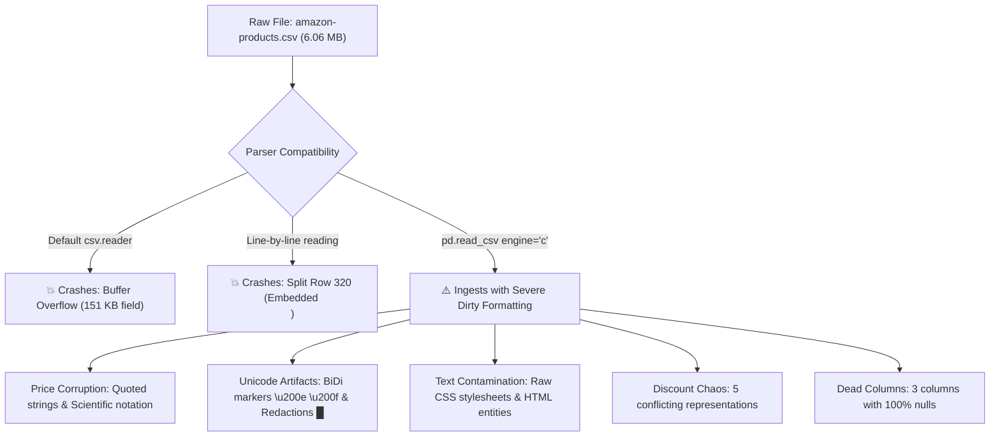

# Comprehensive Data Audit & Formatting Anomaly Report: `amazon-products.csv`

**Dataset Location:** [amazon-products.csv](file:///D:/Anuj/Pearl-ASsignment/amazon-products.csv)  
**File Size:** 6,065,057 bytes (~5.78 MiB / 6.07 MB)  
**Total Records:** 1 Header Row + 1,000 Logical Data Rows  
**Physical Lines:** 1,002 lines  
**Total Columns:** 55 columns  
**Audit Conducted By:** Multi-Agent Diagnostics Team (*Structure & Syntax Inspector*, *Schema & Type Profiler*, *Quality & Anomaly Auditor*)

---

## 1. Executive Summary & Critical Ingestion Blockers

An in-depth multi-agent diagnostic audit of [amazon-products.csv](file:///D:/Anuj/Pearl-ASsignment/amazon-products.csv) revealed several critical structural bugs and subtle semantic formatting anomalies that will break naive ingestion pipelines, SQL loaders, and data transformation scripts:



### Top Critical Issues Identified

1. 🚨 **Python Buffer Overflow (`_csv.Error: field larger than field limit`):**
   - Python's standard `csv.reader` enforces a default buffer limit of 131,072 characters (128 KiB).
   - **Row 162** (ASIN `B01N6OBLAN`) contains a `variations` JSON string of **151,120 characters** (3,103 variant objects).
   - **Row 214** (ASIN `B08N1KL9SM`) contains a `variations` JSON string of **144,045 characters** (2,951 variant objects).
   - *Fix:* Ingestion scripts must explicitly set `csv.field_size_limit(2147483647)`.

2. 🚨 **Embedded Newline Splitting Row 320:**
   - Logical Data Row 320 contains a literal UNIX newline (`\n`, byte `0x0A` at offset `1,939,784`) inside the `discount` field:
     `"₹330₹330    (30%)             \n                      (₹55.00₹55.00 less than buying separately)"`
   - This causes physical line count (1,002 lines) to diverge from logical record count (1,001 rows). Naive line-by-line parsers (`line.split(',')`) will break line 321 into 27 columns and line 322 into 29 columns.

3. 🚨 **Triple-Quoting Artifacts in Pricing Columns:**
   - In `final_price`, **852 rows (85.2%)** are escaped with triple quotes (`"""57.79"""`), parsing into literal string values containing quotation marks: `'"57.79"'`.
   - In `initial_price`, **625 rows (62.5%)** are similarly escaped (`"""27.38"""` $\to$ `'"27.38"'`).
   - Direct casts via `float()`, `pd.to_numeric()`, or SQL `CAST(... AS DECIMAL)` fail immediately with `ValueError: could not convert string to float: '"57.79"'`.

4. 🚨 **Scientific Exponential Notation in Price Fields:**
   - **177 rows** in `initial_price` and **139 rows** in `final_price` are formatted in scientific notation strings (e.g., `'1.795000000000000e+01'` for \$17.95, `'3.999900000000000e+02'` for \$399.99).
   - In **Row 263**, `final_price` contains an embedded thousands comma: `'"3,479.00"'`.

5. 🚨 **100% Dead / Ghost Columns:**
   - `product_details` (1,000 literal `"null"` strings, 0% valid data)
   - `prices_breakdown` (1,000 literal `"null"` strings, 0% valid data)
   - `country_of_origin` (1,000 empty strings `""`, 0% valid data)

6. 🚨 **Invisible Bi-Directional Unicode Marker Contamination:**
   - Left-to-Right (`\u200e`) and Right-to-Left (`\u200f`) marks scraped from Amazon's web tables contaminate 7 text attributes:
     - `manufacturer` (128 rows), `model_number` (124 rows), `product_dimensions` (120 rows), `date_first_available` (70 rows), `item_weight` (49 rows), `department` (44 rows), `upc` (10 rows).
   - These invisible marks break exact string equality matching, database joins, and regex lookups.

7. 🚨 **Raw CSS Stylesheets & HTML Contamination in Descriptions:**
   - **25 rows** in `description` contain raw CSS stylesheet code up to 26 KB (e.g., `.aplus-v2 { display: block; margin-left: auto; ... }`).
   - **32 rows** contain unescaped HTML entities (`&amp;` 84 times, `&gt;` 9 times, `&lt;` 1 time).

---

## 2. Structural & Dialect Audit

| Physical Attribute | Value / Measurement | Diagnostic Finding |
| :--- | :--- | :--- |
| **Byte Size** | 6,065,057 bytes | ~5.78 MiB / 6.07 MB |
| **File Encoding** | Strict **UTF-8** | 0 decode errors, 20,597 non-ASCII characters |
| **Byte Order Mark (BOM)** | **None** | File begins directly with ASCII `"timestamp"` (`0x22 0x74 0x69 0x6D`) |
| **Line Terminator** | Uniform **UNIX LF (`\n` / `0x0A`)** | 0 CRLF, 0 Standalone CR, 1,002 LF. Trailing newline at EOF. |
| **CSV Dialect** | Delimiter: `,` (comma) | RFC 4180 standard double-quote escaping (`""`). 295,811 escaped quotes. |
| **Backslash Quotes** | `\"` in 3,524 places | Used internally inside serialized JSON strings (`features`, `variations`). |
| **Physical Lines** | 1,002 lines | 1 Header + 1,000 Data Rows + 1 Split Row |
| **Logical Rows** | 1,001 rows | Exactly 55 columns in 100% of logical rows (0 broken outer quotes) |

### Parser Compatibility Matrix

| Ingestion Engine / Library | Default Execution Status | Root Cause & Resolution |
| :--- | :---: | :--- |
| **Python standard `csv.reader`** | ❌ **FAILS** | Crashes on Row 162 with `field larger than field limit (131072)`. Set `csv.field_size_limit(2147483647)`. |
| **Pandas (`engine='c'`)** |  **SUCCEEDS** | Dynamically expands memory buffers; loads shape `(1000, 55)`. |
| **Pandas (`engine='python'`)** | ❌ **FAILS** | Delegates to Python's internal `_csv` engine and hits the 128 KiB buffer limit. |
| **Pandas (`engine='pyarrow'`)** |  **SUCCEEDS** | High-performance Arrow parser processes the file cleanly. |
| **Naive Line Splitting (`.split(',')`)** | ❌ **FAILS** | Splits Row 320 at byte `0x0A`, corrupting rows 321 and 322 into 27 and 29 columns. |

---

## 3. Complete 55-Column Schema Profile & Distribution

The dataset contains **55 lowercase snake_case columns** with zero header duplicates. However, missing value sentinels are highly fragmented across three conflicting conventions:
- **Empty String (`""`):** Standard in string/text fields.
- **Literal String `"null"`:** Injected by scrapers in serialized JSON, price, and object fields.
- **Empty JSON Array (`"[]"`):** Explicit empty array containers indicating zero elements rather than unextracted data.

### Comprehensive Schema Reference Table

| # | Column Name | Intended Type | Storage Type | Missing Count (%) | Missing Forms | Distinct Count | Identified Anomalies & Integrity Issues |
| :-: | :--- | :--- | :--- | :-: | :--- | :-: | :--- |
| 1 | `timestamp` | `TIMESTAMP` | String | 0 (0.0%) | None | 141 | Clean ISO-8601 datetimes (`2022-09-06` to `2024-07-10`) |
| 2 | `title` | `VARCHAR` | String | 0 (0.0%) | None | 999 | 1 duplicate title (Row 171 & 508: Skechers Go Joy Sneaker) |
| 3 | `seller_name` | `VARCHAR` | String | 174 (17.4%) | empty: 174 | 569 | **801 rows masked with black block redaction (`█`)** |
| 4 | `brand` | `VARCHAR` | String | 1 (0.1%) | empty: 1 | 894 | Clean brand strings |
| 5 | `description` | `TEXT` | Mixed | 2 (0.2%) | empty: 2 | 995 | **25 rows contain raw CSS stylesheets; 32 rows have HTML entities; Row 660 is `'1'`** |
| 6 | `initial_price` | `DECIMAL(10,2)`| Mixed | 186 (18.6%) | `'null'`: 186 | 484 | **625 quoted (`"""..."""`), 177 scientific notation (`1.795e+01`)** |
| 7 | `final_price` | `DECIMAL(10,2)`| Mixed | 3 (0.3%) | `'null'`: 3 | 667 | **852 quoted, 139 sci notation, Row 263 has comma (`"3,479.00"`)** |
| 8 | `currency` | `CHAR(3)` | String | 0 (0.0%) | None | 3 | Multi-currency: USD (967), INR (31), GBP (2) |
| 9 | `availability` | `VARCHAR` | String | 6 (0.6%) | empty: 6 | 74 | Inconsistent casing/punctuation ('In Stock' vs 'In Stock.') |
| 10 | `reviews_count` | `INTEGER` | Int64 | 0 (0.0%) | None | 737 | Clean integers (range: 1 to 243,907, median: 461.5) |
| 11 | `categories` | `JSON ARRAY` | JSON String | 0 (0.0%) | None | 787 | Valid JSON arrays of category paths |
| 12 | `asin` | `CHAR(10)` | String | 0 (0.0%) | None | 1,000 | 100% unique primary key. **Row 495 is pure numeric `'1631097156'`** |
| 13 | `buybox_seller` | `VARCHAR` | String | 74 (7.4%) | empty: 74 | 658 | Clean unmasked seller counterpart |
| 14 | `number_of_sellers`| `INTEGER` | Float64 | 16 (1.6%) | empty: 16 | 42 | Stored as float due to 16 missing values |
| 15 | `root_bs_rank` | `INTEGER` | Float64 | 1 (0.1%) | empty: 1 | 993 | High variance ranks (range: 30 to 3,931,721) |
| 16 | `answered_questions`| `INTEGER`| Float64 | 31 (3.1%) | empty: 31 | 72 | 826 rows have 0; max: 723 |
| 17 | `domain` | `VARCHAR` | Mixed | 0 (0.0%) | None | 4 | **826 rows store full URL `https://.../`; 174 store bare domain** |
| 18 | `images_count` | `INTEGER` | Int64 | 0 (0.0%) | None | 15 | Clean integer image counts (range: 1 to 18) |
| 19 | `url` | `VARCHAR` | String (URL)| 0 (0.0%) | None | 1,000 | 1,000 distinct product canonical URLs (100% HTTPS) |
| 20 | `video_count` | `INTEGER` | Int64 | 0 (0.0%) | None | 7 | Range: 0 to 6; median: 0 |
| 21 | `image_url` | `VARCHAR` | String (URL)| 5 (0.5%) | empty: 5 | 995 | Clean Amazon CDN thumbnail URLs |
| 22 | `item_weight` | `VARCHAR` | String | 247 (24.7%) | empty: 247 | 548 | **49 rows contain invisible BiDi marker `\u200e`; mixed units** |
| 23 | `rating` | `DECIMAL(2,1)` | Float64 | 0 (0.0%) | None | 22 | Clean ratings (range: 2.5 to 5.0, mean: 4.40) |
| 24 | `product_dimensions`| `VARCHAR` | String | 67 (6.7%) | empty: 67 | 891 | **120 rows contain BiDi markers; mixes dimensions + weight** |
| 25 | `seller_id` | `VARCHAR` | String | 0 (0.0%) | None | 671 | Clean merchant IDs (top: `ATVPDKIKX0DER` Amazon retail) |
| 26 | `date_first_available`| `DATE` | Mixed | 79 (7.9%) | empty: 79 | 813 | **70 rows contain BiDi markers; mixed date formats** |
| 27 | `discount` | `VARCHAR` | Mixed | 179 (17.9%) | empty: 179 | 211 | **Severe fragmentation: %, bare ints, $, ₹, multiline** |
| 28 | `model_number` | `VARCHAR` | Mixed | 108 (10.8%) | empty: 108 | 886 | **124 rows contain BiDi markers; 147 pure integers** |
| 29 | `manufacturer` | `VARCHAR` | String | 30 (3.0%) | empty: 30 | 886 | **128 rows contain BiDi markers (`\u200e`, `\u200f`)** |
| 30 | `department` | `VARCHAR` | String | 338 (33.8%) | empty: 338 | 79 | **44 BiDi rows; casing splits (`womens`/`Womens`, `mens`/`Mens`)** |
| 31 | `plus_content` | `BOOLEAN` | Bool | 0 (0.0%) | None | 2 | Clean boolean (`true`: 847, `false`: 153) |
| 32 | `upc` | `CHAR(12)` | Mixed | 901 (90.1%) | empty: 901 | 99 | **90.1% missing; 31 rows concatenate multiple UPCs in one cell** |
| 33 | `video` | `BOOLEAN` | Bool | 0 (0.0%) | None | 2 | **Contradicts `video_count`: 72 rows have `video=false` but count > 0** |
| 34 | `top_review` | `TEXT` | String | 8 (0.8%) | empty: 8 | 991 | Clean customer review text snippets |
| 35 | `variations` | `JSON ARRAY` | JSON String | 319 (31.9%) | `'null'`: 258; `'[]'`: 61 | 681 | **Rows 162 & 214 exceed 144 KB, triggering buffer overflow** |
| 36 | `delivery` | `JSON ARRAY` | JSON String | 54 (5.4%) | `'null'`: 52; `'[]'`: 2 | 935 | Valid JSON delivery promise arrays |
| 37 | `features` | `JSON ARRAY` | JSON String | 201 (20.1%) | `'null'`: 182; `'[]'`: 19| 798 | Valid JSON bullet point arrays |
| 38 | `format` | `JSON ARRAY` | JSON String | 998 (99.8%) | `'null'`: 555; `'[]'`: 443| 2 | **99.8% missing / dead column (only 2 valid rows)** |
| 39 | `buybox_prices` | `JSON OBJECT`| JSON String | 182 (18.2%) | `'null'`: 182 | 640 | Valid JSON pricing metadata objects |
| 40 | `parent_asin` | `CHAR(10)` | String | 617 (61.7%) | empty: 617 | 382 | 61.7% missing; variation parent container |
| 41 | `input_asin` | `CHAR(10)` | String | 627 (62.7%) | empty: 627 | 373 | 62.7% missing; crawl query seed |
| 42 | `ingredients` | `TEXT` | String | 954 (95.4%) | empty: 954 | 44 | **95.4% missing; contains invalid entries ('plastic', 'No')** |
| 43 | `origin_url` | `VARCHAR` | String (URL)| 759 (75.9%) | empty: 759 | 23 | Best Sellers category browse URL seeds |
| 44 | `bought_past_month`| `INTEGER` | Float64 | 796 (79.6%) | empty: 796 | 15 | Amazon rounded purchase metrics (50, 100, 200... 10000) |
| 45 | `is_available` | `BOOLEAN` | Bool | 783 (78.3%) | empty: 783 | 1 | **Degenerate column: 100% of non-null values are `'true'`** |
| 46 | `root_bs_category`| `VARCHAR` | String | 894 (89.4%) | empty: 894 | 23 | 89.4% missing top-level category name |
| 47 | `bs_category` | `VARCHAR` | String | 894 (89.4%) | empty: 894 | 104 | 89.4% missing leaf-level category name |
| 48 | `bs_rank` | `INTEGER` | Float64 | 894 (89.4%) | empty: 894 | 76 | 89.4% missing category rank |
| 49 | `badge` | `VARCHAR` | String | 924 (92.4%) | empty: 924 | 3 | **Double-space typo: `"Amazon's  Choice"` (73 rows)** |
| 50 | `subcategory_rank`| `JSON ARRAY`| JSON String | 895 (89.5%) | `'null'`: 894; `'[]'`: 1 | 105 | 89.5% missing nested subcategory rank JSON arrays |
| 51 | `amazon_choice` | `BOOLEAN` | Bool | 894 (89.4%) | empty: 894 | 2 | Mirrors `badge == "Amazon's  Choice"` (`true`: 73, `false`: 33) |
| 52 | `images` | `JSON ARRAY` | JSON String | 948 (94.8%) | `'null'`: 948 | 52 | **94.8% missing full gallery JSON arrays (only 52 populated)** |
| 53 | `product_details` | `JSON / TEXT`| Dead Column | 1,000 (100.0%)| `'null'`: 1000 | 0 | **100% dead column (1,000 literal `"null"` strings)** |
| 54 | `prices_breakdown`| `JSON / TEXT`| Dead Column | 1,000 (100.0%)| `'null'`: 1000 | 0 | **100% dead column (1,000 literal `"null"` strings)** |
| 55 | `country_of_origin`| `VARCHAR` | Dead Column | 1,000 (100.0%)| empty: 1000 | 0 | **100% dead column (1,000 empty strings)** |

---

## 4. Deep-Dive: Specific Formatting & Semantic Anomalies

### 4.1 Price & Mathematical Inconsistencies

1. **Identical Prices with Reported Discounts (87 rows):**
   - In 87 products, `initial_price == final_price` down to the cent, yet a substantial discount is listed:
     - Row 5 (`B0BGSF52LR`): `initial_price = 17.88`, `final_price = 17.88`, `discount = '-13%'`
     - Row 13 (`B0CN8RQYDG`): `initial_price = 44.99`, `final_price = 44.99`, `discount = '-12%'`
     - Row 102 (`B01HEONU10`): `initial_price = 34.00`, `final_price = 34.00`, `discount = '-55%'`
     - Row 203 (`B003IHVN2G`): `initial_price = 44.99`, `final_price = 44.99`, `discount = '-82%'`
2. **Inverted Price Anomaly (1 row):**
   - **Row 992** (`B015G7T7UA`): `initial_price = "11.39"`, `final_price = "12.03"` (final price is \$0.64 **higher** than initial price, while discount is recorded as `"$0.91"`).
3. **Discount Math Mismatches (91 rows):**
   - 91 rows with both prices populated deviate by >1% from the formula $(P_{\text{init}} - P_{\text{final}}) / P_{\text{init}} \times 100$.
4. **Discount Present Without Initial Price (61 rows):**
   - 61 rows report a discount value despite `initial_price` being `NaN`/`'null'`.

### 4.2 Encoding, Character Corruption & Obfuscation

1. **CP1252 / Latin-1 Raw Byte Leakage (Row 975):**
   - ASIN `B000BRW84K` in `description` contains raw C1 control characters `\x96` and `\x85` (Windows-1252 en-dash and ellipsis decoded improperly into UTF-8):
     `'crimp any crimp bead of "medium" size, 2mm \x96 3mm and various shapes...'`
2. **Invisible BiDi Control Pollution (300+ total rows):**
   - Scraped from Amazon's localized HTML tables. Characters `\u200e` (Left-to-Right mark) and `\u200f` (Right-to-Left mark) prefix text values in 7 columns.
3. **Seller Name Redaction (801 rows):**
   - 97.0% of valid seller names are masked with full block characters `█` (`\u2588`, e.g. `'Ama███.co███'`, `'Orv███tor███'`).
   - *Workaround:* True unmasked seller identities are available in the `buybox_seller` column (`'Amazon.com'`).
4. **Styled Mathematical Font Glyphs (Rows 74, 539, 908):**
   - `features` contains >400 characters rendered with Unicode styled math glyphs (e.g. `𝖾`, `𝗂`, `𝗈`, `𝗋`) instead of standard ASCII letters.

---

## 5. Automated Data Cleaning & Normalization Pipeline

To safely ingest this dataset without data loss or parser crashes, use the following tested Python remediation pipeline:

```python
import csv
import re
import html
import numpy as np
import pandas as pd

# 1. Expand Python CSV field size limit to prevent buffer overflow
csv.field_size_limit(2147483647)

def clean_amazon_dataset(csv_path: str, output_path: str):
    # 2. Read with C engine, treating both 'null' and empty strings as NaN
    df = pd.read_csv(
        csv_path,
        engine='c',
        dtype=str,
        keep_default_na=False
    )
    
    # Standardize null sentinels
    df = df.replace({'null': np.nan, '': np.nan})

    # 3. Drop completely dead columns (100% missing)
    dead_columns = ['product_details', 'prices_breakdown', 'country_of_origin']
    df = df.drop(columns=dead_columns, errors='ignore')

    # 4. Clean Numeric Prices
    def sanitize_price(val):
        if pd.isna(val):
            return np.nan
        # Strip escaped quotes, currency symbols, and commas
        cleaned = re.sub(r'[\"\'$,₹\s]', '', str(val))
        try:
            return float(cleaned)
        except ValueError:
            return np.nan

    df['initial_price'] = df['initial_price'].apply(sanitize_price)
    df['final_price'] = df['final_price'].apply(sanitize_price)

    # 5. Strip BiDi markers and unprintable characters across all text fields
    def strip_invisible(val):
        if pd.isna(val) or not isinstance(val, str):
            return val
        # Strip \u200e, \u200f, \u200b, \u00a0, C1 controls
        s = re.sub(r'[\u200e\u200f\u200b\u200d\x96\x85]', '', val)
        s = s.replace('\u00a0', ' ')
        return s.strip()

    text_cols = df.select_dtypes(include='object').columns
    for col in text_cols:
        df[col] = df[col].apply(strip_invisible)

    # 6. Unescape HTML entities & strip CSS stylesheets in description
    def sanitize_description(val):
        if pd.isna(val):
            return val
        s = html.unescape(val)
        # Strip embedded .aplus-v2 CSS stylesheets
        s = re.sub(r'\.aplus-v2\s*\{[^}]*\}', '', s)
        s = re.sub(r'<style[^>]*>.*?</style>', '', s, flags=re.DOTALL)
        return re.sub(r'\s+', ' ', s).strip()

    df['description'] = df['description'].apply(sanitize_description)

    # 7. Normalize domain to clean hostname
    def normalize_domain(val):
        if pd.isna(val):
            return val
        val = re.sub(r'^https?://', '', val)
        return val.rstrip('/')

    df['domain'] = df['domain'].apply(normalize_domain)

    # 8. Normalize badge double-space typo
    df['badge'] = df['badge'].replace({"Amazon's  Choice": "Amazon's Choice"})

    # 9. Clean discount newline and parse numeric discount
    def parse_discount_pct(val):
        if pd.isna(val):
            return np.nan
        val = str(val).replace('\n', ' ')
        m = re.search(r'(\d+)\s*%', val)
        if m:
            return float(m.group(1))
        # Check bare integer
        if re.fullmatch(r'\d+', val.strip()):
            return float(val.strip())
        return np.nan

    df['discount_percentage'] = df['discount'].apply(parse_discount_pct)

    # Export clean standardized dataset
    df.to_csv(output_path, index=False, quoting=csv.QUOTE_MINIMAL)
    print(f"Cleaned dataset exported to: {output_path} (Shape: {df.shape})")

if __name__ == '__main__':
    clean_amazon_dataset(r'D:\Anuj\Pearl-ASsignment\amazon-products.csv', r'D:\Anuj\Pearl-ASsignment\amazon-products-cleaned.csv')
```

---

## 6. Actionable Next Steps

1. **Ingestion Safe Execution:** Update any ingestion scripts with `csv.field_size_limit(2147483647)` to avoid crashes on rows 162 and 214.
2. **Schema Pruning:** Drop the 3 completely empty columns (`product_details`, `prices_breakdown`, `country_of_origin`) and consider removing `format` (99.8% missing).
3. **Run Cleaning Pipeline:** Execute the cleaning script above to produce a sanitized, query-ready dataset for downstream SQL analytics or machine learning models.
